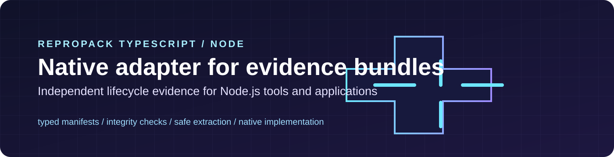
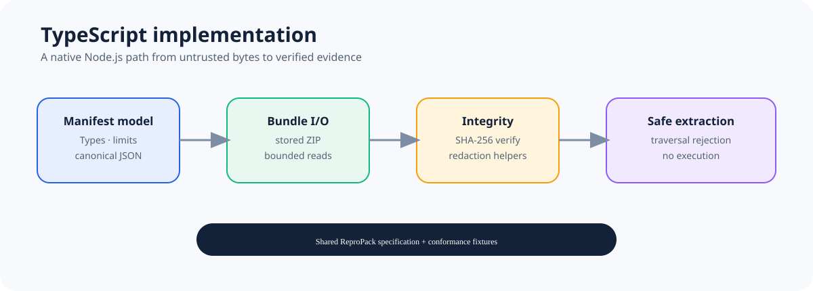

# ReproPack for TypeScript

<p align="center"></p>

<p align="center">
  <a href="https://github.com/ReproPack/repropack-typescript/actions/workflows/ci.yml"></a>
  <a href="https://img.shields.io/badge/runtime-Node.js%2022-2f6f9f"></a>
  <a href="LICENSE"></a>
  <a href="https://www.npmjs.com/package/repropack-typescript"></a>
  <a href="https://img.shields.io/badge/status-v0.1.1%20released-2ea44f"></a>
</p>

ReproPack for TypeScript is a native Node.js SDK for creating, reading, validating, verifying, redacting, and safely extracting ReproPack evidence bundles. It connects Node.js tools to the shared contract without invoking Rust.

## Repository role

This repository is the TypeScript implementation and adapter. It owns the Node.js package, typed APIs, stored-ZIP I/O, integrity helpers, safe extraction, and implementation-level tests. The canonical format remains in [repropack-core](https://github.com/ReproPack/repropack-core).

## Architecture

<p align="center"></p>

## What you get

- typed manifest validation and canonical JSON;
- stored-ZIP bundle creation and reading;
- integrity verification and explicit redaction helpers;
- bounded reads and safe extraction that rejects unsafe paths;
- shared semantic fixtures used by the ReproPack ecosystem.

The SDK consumes the Core specification and shared fixtures independently. Passing conformance and interoperability checks does not certify future integrations or arbitrary external consumers.

## Quickstart

```bash
npm ci
npm run typecheck
npm test
npm install repropack-typescript
```

The public SDK surface is exported from `src/model.ts`, `src/bundle.ts`, and `src/redaction.ts`. Build the package with:

```bash
npm run build
npm pack --dry-run
```

For the format walkthrough, see the Core [tutorial](https://github.com/ReproPack/repropack-core/blob/main/docs/TUTORIAL.md) and [CI integration example](https://github.com/ReproPack/repropack-core/blob/main/docs/CI_INTEGRATION.md).

## Documentation and status

| Need | Start here |
| --- | --- |
| Understand the format | [Core specification](https://github.com/ReproPack/repropack-core/blob/main/docs/SPECIFICATION.md) |
| See TypeScript API behavior | [Specification mapping](docs/SPECIFICATION_MAPPING.md) |
| Understand implementation boundaries | [Architecture](docs/ARCHITECTURE.md) |
| Run tests and contribute | [Development guide](docs/DEVELOPMENT.md) |
| Review compatibility | [Conformance guide](docs/CONFORMANCE.md) |
| Follow project progress | [Roadmap](ROADMAP.md) |

## Status

v0.1.1 is released on GitHub and `repropack-typescript@0.1.1` is publicly available on npm. Future integrations remain outside the current package contract.

## Related repositories

| Repository | Role | Link |
| --- | --- | --- |
| **repropack-core** | Specification, schema, fixtures, Rust reference model, and CLI | [Core](https://github.com/ReproPack/repropack-core) |
| **repropack-typescript** | Native Node.js SDK and adapter | This repository |
| **repropack-python** | Native Python SDK and adapter | [Python](https://github.com/ReproPack/repropack-python) |

## Project links

[License](LICENSE) · [Contributing](CONTRIBUTING.md) · [Security](SECURITY.md) · [Code of Conduct](CODE_OF_CONDUCT.md) · [Changelog](CHANGELOG.md) · [Support](SUPPORT.md)
